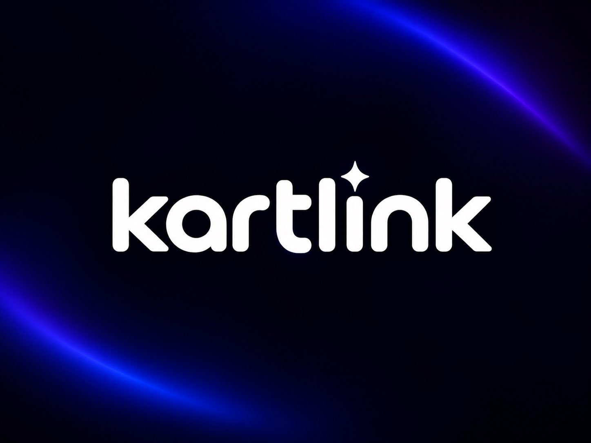

<h1 align="center">KartLink P2P</h1>

Host an Eglantine room for friends using Playit.

## Download

Download the installer or portable ZIP from the [experimental Windows release](https://github.com/js664/KartLink-P2P/releases/tag/v1.0.2). For the portable version, extract the entire ZIP to a writable folder before opening the app. No Eglantine patch is required. The builds are unsigned; Windows may show a warning.

## Play

1. **Host:** Open KartLink P2P, connect Playit, and create a room. Send your friends the address, port, and password, if set. Keep the app open.
2. **Everyone:** In Eglantine, open **Emulation → Configure → Network** and uncheck **Enable Airplane Mode**. Menu names may differ between forks.
3. **Everyone:** Select **Multiplayer → Direct Connect to Room** in Eglantine. The host uses `127.0.0.1` and port `6009`; friends use the address and port shown in KartLink.
4. **Everyone:** In Mario Kart World’s mode menu, hold **L + R** and click the **left stick** to switch Wireless Play to LAN Play. One player creates the game lobby; the others join it.

The app includes these instructions under **How to play**. Playit may require an account and impose tunnel limits or fees. Compatible game and emulator versions are required.

## Build

Install Node.js, then run `npm ci`, `npm test`, `npm run build`, and `npm start`. Run `npm run package` to build a portable Windows executable. The [release](https://github.com/js664/KartLink-P2P/releases/tag/v1.0.2) also contains the matching room-server source snapshot.

See [TESTING.md](TESTING.md) for test results and outstanding work, and [PRIVACY.md](PRIVACY.md) for how credentials and room access are handled. The app is GPL-3.0-or-later; the bundled Playit agent has its own [license](resources/LICENSE-Playit.txt).

The navigation uses a locally adapted copy of the [PinUI Chips component](https://www.pinui.xyz/r/chips.json); the remaining interface uses PanelUI.

## Build Windows distributions

Run `npm ci` and `npm run package` on Windows. The version in `package.json` is used to create `release-build/KartLink-P2P-Setup-<version>.exe` and `release-build/KartLink-P2P-Portable-<version>.zip`. To build only one format, run `npm run package:installer` or `npm run package:portable`.

The installer supports a per-user installation directory, Start menu and desktop shortcuts, and an uninstaller. Extract the portable ZIP completely to a writable folder before running it. Its settings and Playit connection live in `KartLink-data` beside the executable, separately from the installed app. Windows encrypts the Playit credential for the current Windows user and computer, so reconnect Playit after moving the folder to another PC or account.
